# Manuel d'utilisation : « Carnet de stage »

Ce manuel s'adresse à l'**apprenant**. Il décrit chaque écran de l'application à partir du **compte de
démonstration**. Les données du compte sont fictives : entreprise EDEMO, chantier Résidence Démo (R+10) à Douala,
stage du 1er juin au 19 septembre 2026.

Le scénario complet, du premier au dernier jour du stage, est dans [scenario-stage.md](scenario-stage.md).

## Sommaire

1. [Accès et compte de démonstration](#1-accès-et-compte-de-démonstration)
2. [Tableau de bord](#2-tableau-de-bord)
3. [Décrire le stage](#3-décrire-le-stage)
4. [Note rapide sur le téléphone](#4-note-rapide-sur-le-téléphone)
5. [Compléter une note dans le journal](#5-compléter-une-note-dans-le-journal)
6. [Fiche entreprise, Mission et Bilan personnel](#6-fiche-entreprise-mission-et-bilan-personnel)
7. [Photos](#7-photos)
8. [Lieux](#8-lieux)
9. [Rubriques et chapitres du thème](#9-rubriques-et-chapitres-du-thème)
10. [Données structurées](#10-données-structurées)
11. [Calendrier et absences](#11-calendrier-et-absences)
12. [Dossier terrain : export et sauvegarde](#12-dossier-terrain--export-et-sauvegarde)
13. [Et ensuite : le rapport](#13-et-ensuite--le-rapport)
14. [Le formateur et le rapport](#14-le-formateur-et-le-rapport)
15. [Questions fréquentes](#15-questions-fréquentes)

---

## 1. Accès et compte de démonstration

| | |
|---|---|
| Site en ligne | <https://esrventisax.pythonanywhere.com> |
| En local | `http://127.0.0.1:8000`, après `manage.py charger_demo` (voir le [README](../../README.md)) |
| Identifiant | `demo.apprenant` |
| Mot de passe | `demo-local-2026` (public par choix, décision A38) |

Chaque apprenant crée lui-même son compte sur la page **Créer un compte** (inscription libre, sans code) et
l'active par le lien reçu par courriel. Mot de passe oublié : lien **Mot de passe oublié ?** sous la connexion.
Le formateur n'a pas de compte : son nom se saisit dans la couverture du stage (section 14).

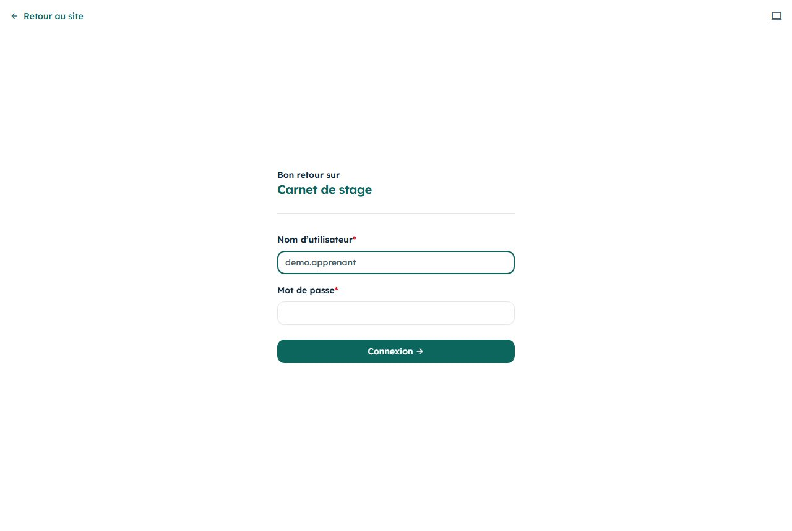

*Figure 1 : page de connexion.*

L'adresse racine ouvre directement la **Note rapide** : c'est l'écran du terrain. Le **tableau de bord** est sur
`/admin/`. Sur le téléphone, les trois icônes de l'en-tête mènent à la Note rapide, au Tri des photos et au
Tableau de bord.

> Le compte de démonstration est partagé. Tout ce que vous y saisissez peut être effacé à tout moment par
> `charger_demo`, qui remet la démo à neuf.

## 2. Tableau de bord

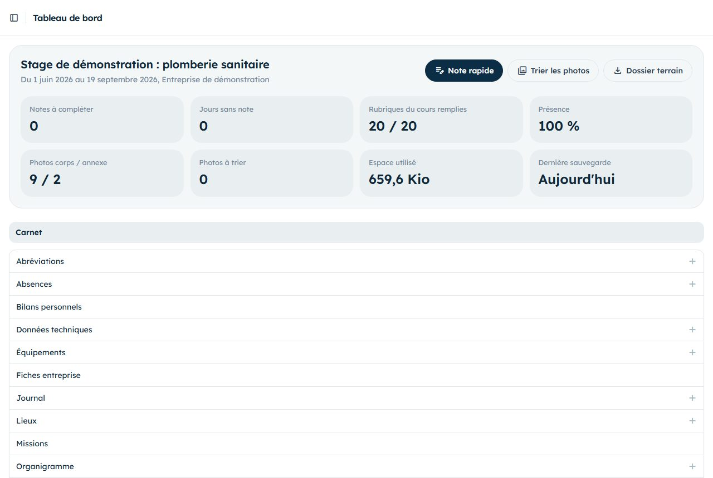

*Figure 2 : tableau de bord du stage de démonstration en fin de stage : tous les indicateurs sont au vert.*

En haut, l'intitulé et les dates du **stage actif**, puis trois boutons : **Note rapide**, **Trier les photos** et
**Dossier terrain** (téléchargement du zip). En dessous, huit indicateurs. Une case passe en **orange** quand il
faut agir.

| Indicateur | Ce qu'il compte | Orange quand… |
|---|---|---|
| Notes à compléter | Notes rapides pas encore complétées dans le journal | au moins une note |
| Jours sans note | Jours travaillés écoulés sans aucune note | au moins un jour |
| Rubriques du cours remplies | Rubriques de la Fiche entreprise et de la Mission remplies (sur 20) | — (« Voir les rubriques encore vides » les liste) |
| Présence | Jours travaillés moins les absences, sur les jours prévus | — |
| Photos corps / annexe | Photos qui iront dans le rapport | plus de 25 photos dans le corps |
| Photos à trier | Photos sans destination | au moins une photo |
| Espace utilisé | Place occupée par les photos du stage (quota : 80 Mo) | — |
| Dernière sauvegarde | Âge du dernier zip téléchargé | jamais, ou plus de 7 jours |

Sous les indicateurs, la liste des formulaires (Abréviations, Absences, Journal, Lieux…) donne accès à tout le
reste. Le menu latéral offre la même liste, avec une recherche.

Sur le téléphone, le tableau de bord s'affiche sur deux colonnes :

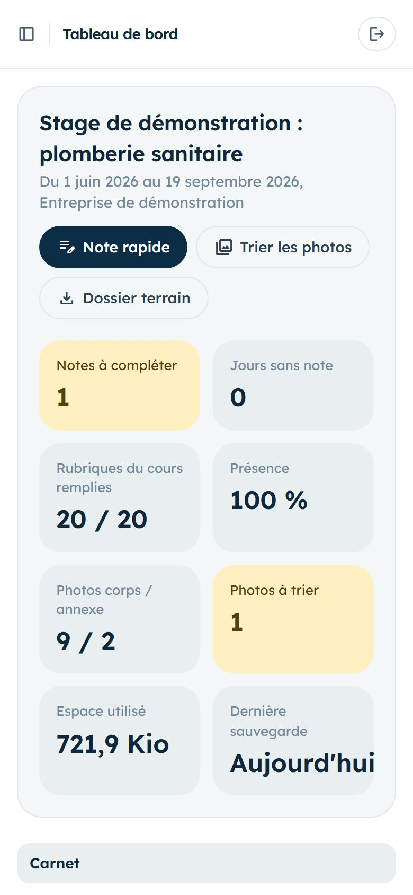

*Figure 3 : tableau de bord à 390 px, juste après une note rapide : une note à compléter et une photo à trier.*

### Plusieurs stages

Un apprenant peut avoir plusieurs stages. Le **stage actif** est choisi dans la liste déroulante en haut de la
Note rapide ; ce choix est gardé pour toute la session et vaut aussi pour le tableau de bord. La liste n'apparaît
que si vous avez au moins deux stages.

## 3. Décrire le stage

Au tout premier accès, sans stage, le tableau de bord affiche **Bienvenue** et le bouton **Créer mon stage**.
Le formulaire du stage se trouve aussi dans **Stages**.

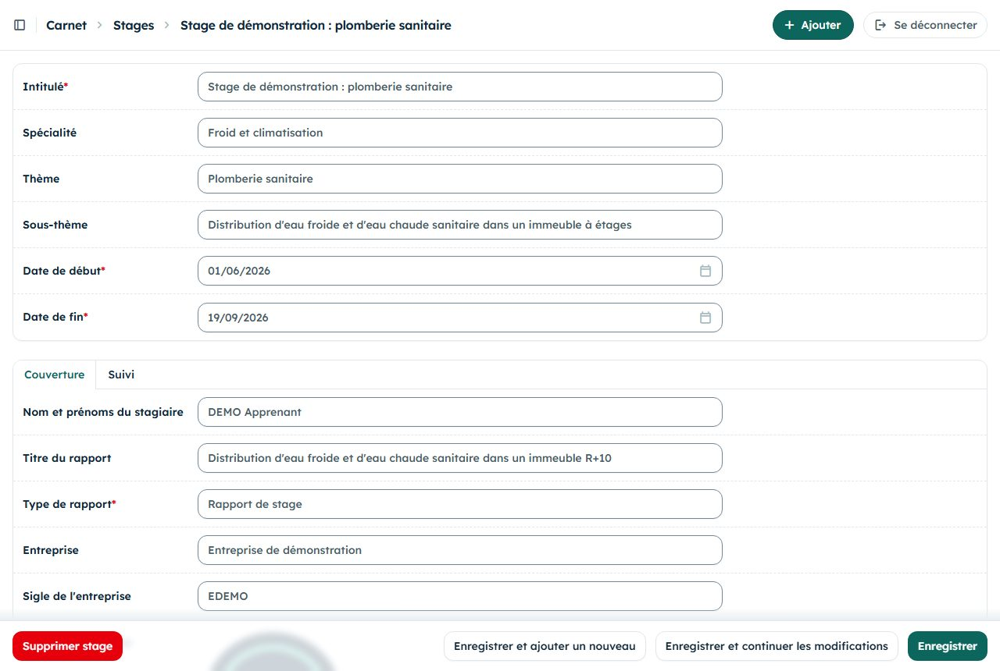

*Figure 4 : formulaire du stage, partie générale.*

- **Partie générale** : intitulé, spécialité, thème, sous-thème, dates de début et de fin. Rien n'est imposé :
  l'application ne connaît à l'avance ni l'entreprise, ni la spécialité, ni le thème.
- **Onglet Couverture** : les champs de la page de couverture exigés par le cours (nom du stagiaire, titre du
  rapport, entreprise et sigle, centre de formation professionnelle et sigle, diplôme, année d'étude, session, responsable professionnel et
  **formateur (responsable académique)** avec leurs postes), ainsi que les logos de l'entreprise et du centre de formation professionnelle.
- **Onglet Suivi** : jours travaillés (lundi à samedi par défaut), quota (réglé par l'administrateur, en
  lecture seule) et date de la dernière sauvegarde.

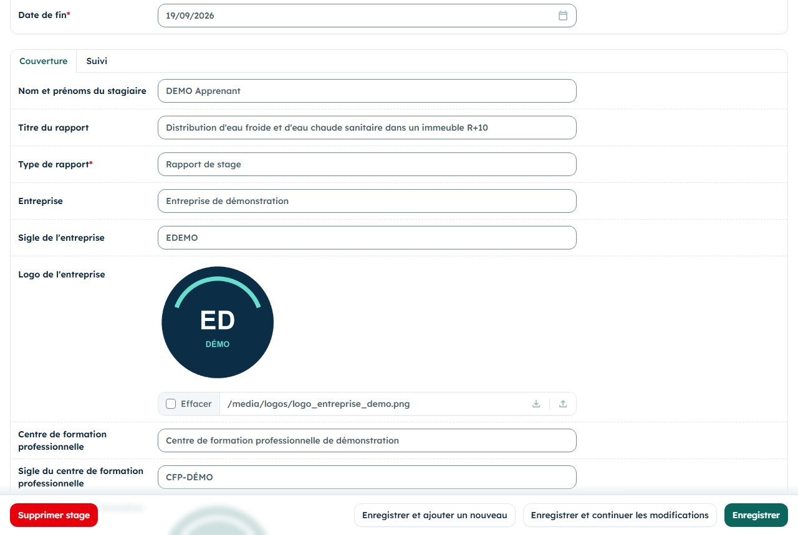

*Figure 5 : onglet Couverture.*

Tous les champs sont facultatifs à la saisie. Un champ vide n'empêche rien : il devient « [À COMPLÉTER] » dans le
rapport.

## 4. Note rapide sur le téléphone

C'est l'écran que l'on utilise **chaque jour, sur le chantier**. Il tient en **trois actions** :

1. écrire quelques phrases ;
2. prendre une photo (**Prendre** ouvre l'appareil photo, **Galerie** choisit des images existantes) ;
3. toucher **Enregistrer la note**.

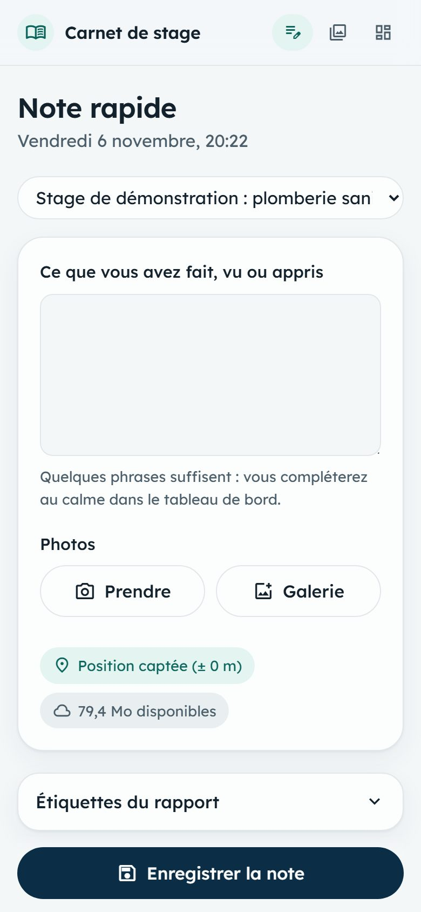 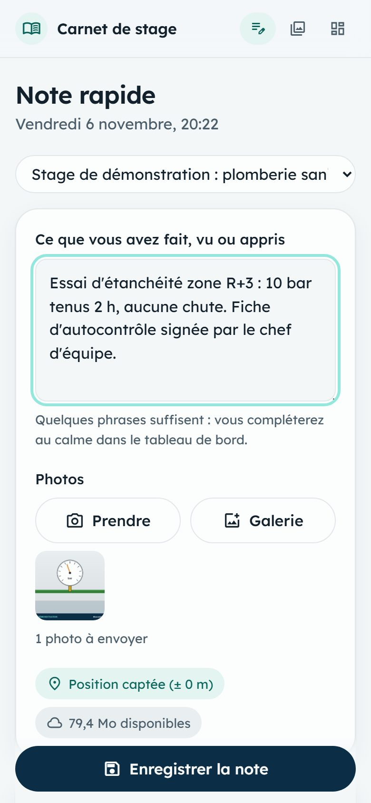

*Figures 6 et 7 : la Note rapide avant et après saisie. La position est captée, la photo est prête à partir.*

Ce qui se fait tout seul :

- **date et heure** : celles de l'enregistrement, affichées sous le titre ;
- **position GPS** : l'étiquette passe de « Position non captée » à « Position captée (± n m) ». Autorisez la
  localisation dans le navigateur. La note est rattachée au **lieu** le plus proche, à moins de 200 m ;
- **brouillon** : le texte et les étiquettes cochées restent dans le navigateur. Une page rechargée ou une
  coupure de réseau ne fait rien perdre ; le brouillon s'efface après l'enregistrement ;
- **quota** : l'espace restant est affiché (« 79,4 Mo disponibles »). Au-delà du quota, l'envoi est refusé avec le
  message « Quota de 80 Mo atteint pour ce stage… ».

**Étiquettes du rapport** (facultatif) : ouvrez ce volet pour indiquer la partie du rapport où la note servira.
Les étiquettes suivent le plan du cours : Introduction, Partie I Entreprise, Partie II Mission, Partie III Thème
(vos chapitres), Partie IV Critiques et suggestions, Conclusion, Bilan personnel, Annexes. On peut en cocher
plusieurs.

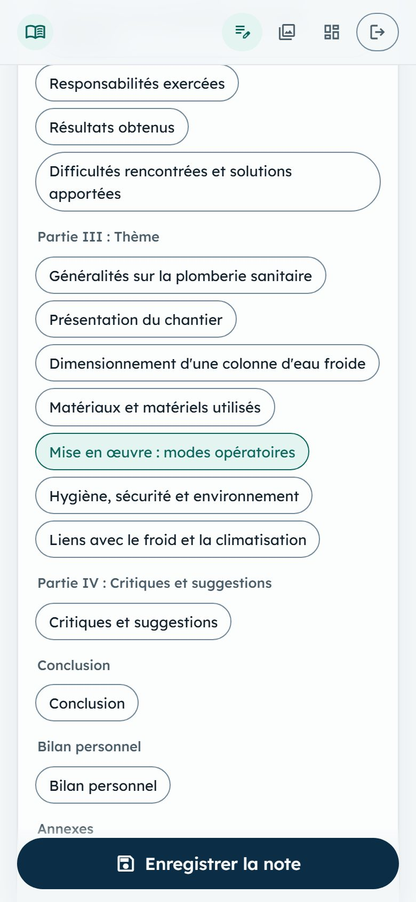 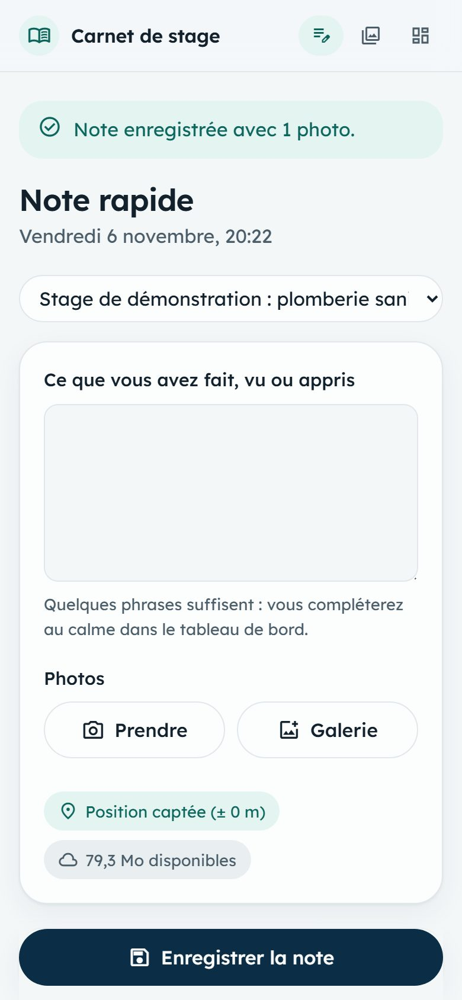

*Figures 8 et 9 : une étiquette de la Partie III cochée, puis le message « Note enregistrée avec 1 photo. »*

Le mode sombre suit le réglage du téléphone :

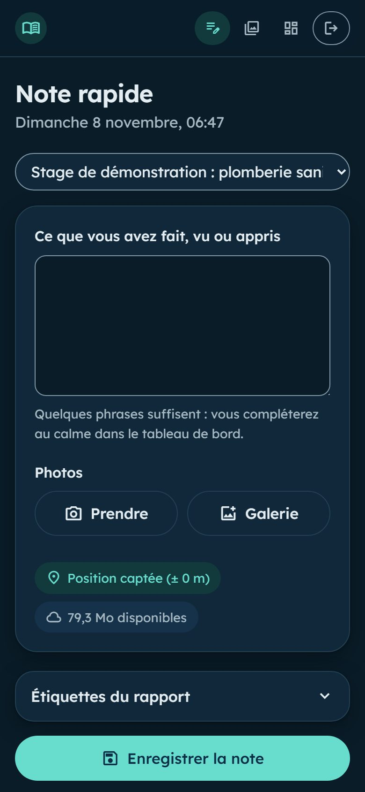

*Figure 10 : Note rapide en mode sombre.*

> L'application fonctionne **en ligne** uniquement. Sans réseau, écrivez quand même : le brouillon est gardé,
> et vous enregistrerez dès que le réseau revient.

## 5. Compléter une note dans le journal

Le soir ou en fin de semaine, au calme, ouvrez **Journal** (ou le lien « Compléter mes notes » en bas de la Note
rapide). La liste se filtre par mois, par rubrique et par état « Complétée ».

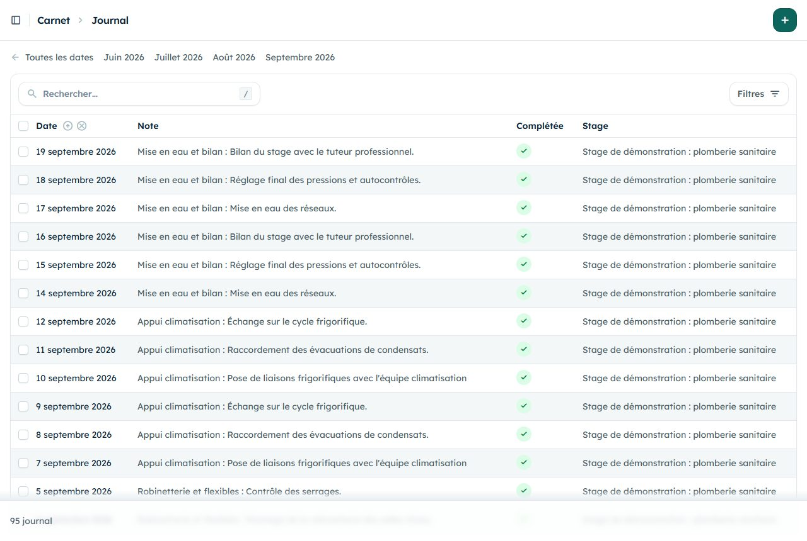

*Figure 11 : le journal du stage de démonstration : 95 notes, toutes complétées.*

Une note s'ouvre sur sa partie générale (date, heure, texte saisi sur le terrain, étiquettes, case
**Complétée**), puis quatre onglets :

| Onglet | Champs | Sert à… |
|---|---|---|
| Rapport d'activité | objectifs visés, moyens humains, moyens matériels, méthodologie, activités, éléments théoriques, difficultés, solutions, appréciation | la Partie II et la Partie III |
| Intervention | nature, durée d'immobilisation (h), coût (F CFA), ressources | les interventions de dépannage ou de reprise |
| Liens | lieu, tâche, équipements, personnes | relier les faits entre eux |

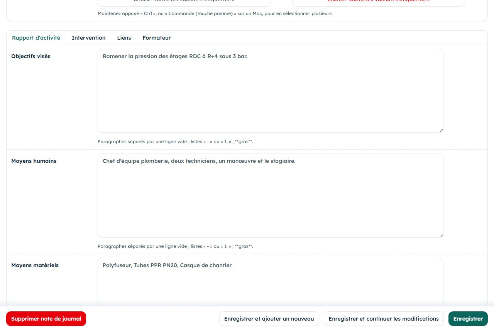

*Figure 12 : onglet Rapport d'activité de la note du 17 août 2026 (réglage des réducteurs).*

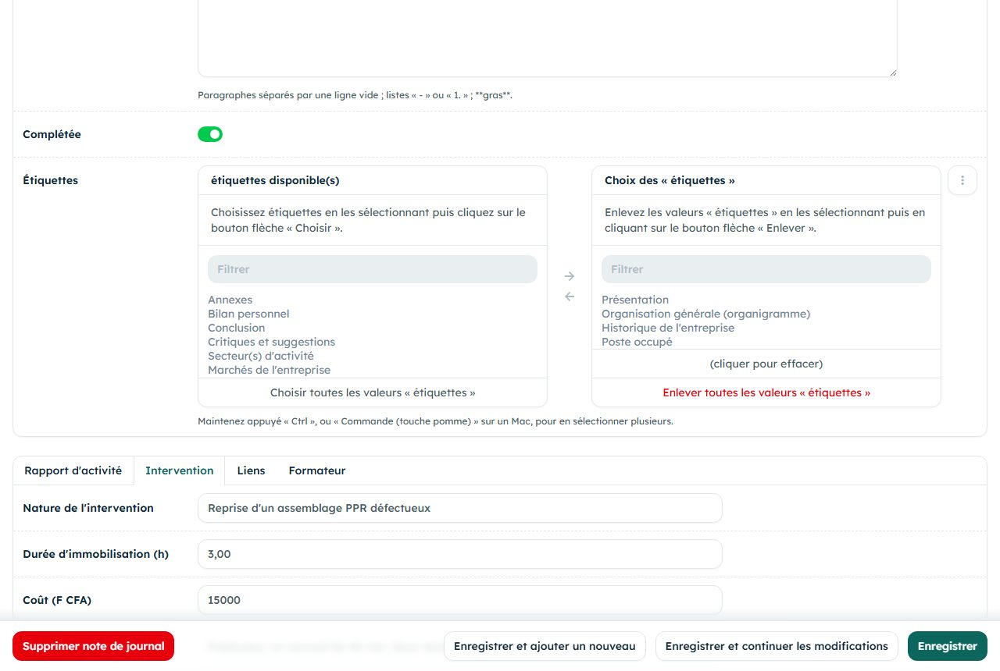

*Figure 13 : onglet Intervention.*

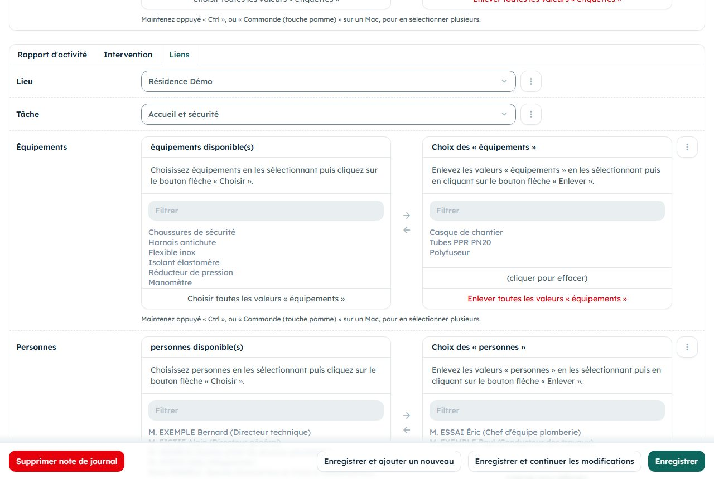

*Figure 14 : onglet Liens.*

Cochez **Complétée** quand la note est prête : elle sort du compteur « Notes à compléter ».

Les textes acceptent un **Markdown minimal** : paragraphes séparés par une ligne vide, listes commençant par
« - » ou « 1. », **gras** entre deux astérisques. Pas de titres, de tableaux ni d'images dans le texte. Les
caractères spéciaux (`& % $ # _ { } ~ ^ \`, « 50 % ») sont échappés à l'export : écrivez-les normalement.

## 6. Fiche entreprise, Mission et Bilan personnel

Ces trois formulaires existent en un seul exemplaire par stage. Ils reprennent les rubriques du cours
« Module 2 ».

**Fiche entreprise** (Partie I) : présentation, organisation générale, historique, secteurs d'activité, marchés,
clients et fournisseurs, concurrence, chiffres clés, perspectives (forces, faiblesses, opportunités, menaces),
mutations technologiques, volonté des dirigeants ; puis les données d'identité (ville, quartier, année de
création, dirigeant, capital, effectif, contact).

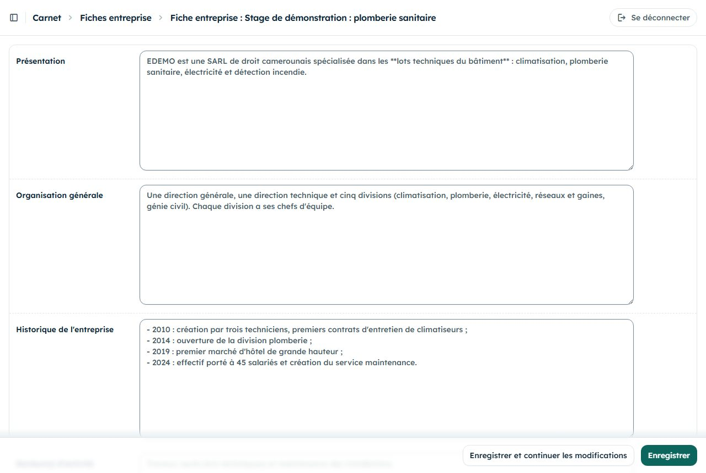

*Figure 15 : Fiche entreprise. Le Markdown est visible dans le champ (gras, listes de l'historique).*

**Mission** (Partie II) : poste occupé, position dans l'organigramme, faits importants, objectifs et enjeux,
méthodes et moyens, collaborateurs, responsabilités, résultats, difficultés et solutions.

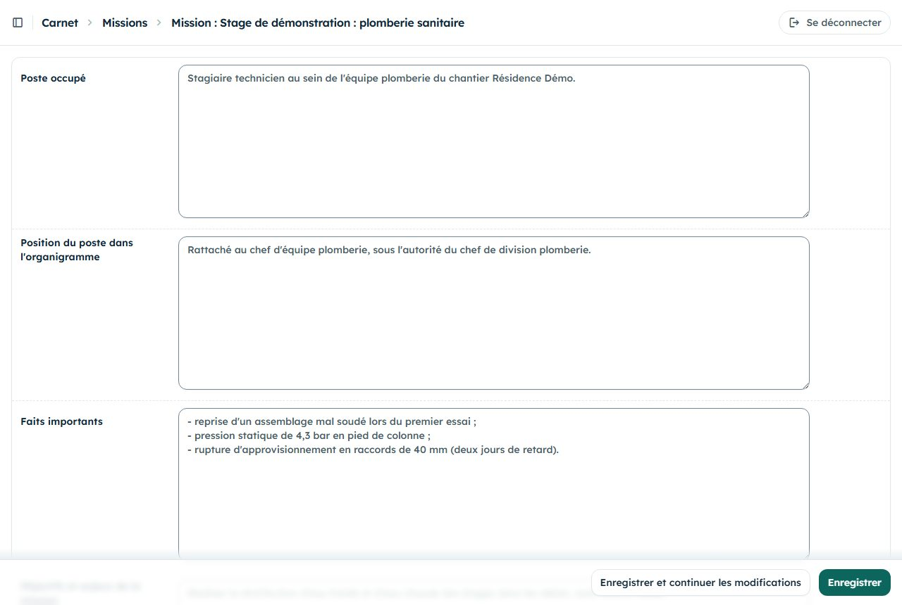

*Figure 16 : Mission.*

**Bilan personnel** (Partie IV et conclusion) : pourquoi ce stage, appréciation, attentes atteintes, appréciation
comme stagiaire, résultats et remarques, travail en équipe, conséquence sur la carrière, critiques, suggestions.

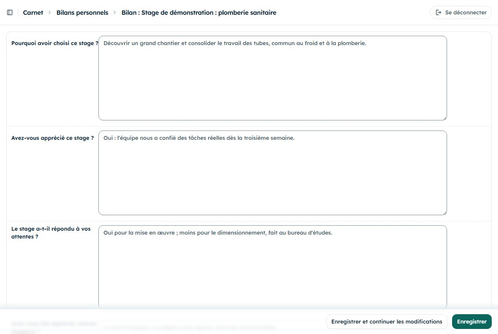

*Figure 17 : Bilan personnel.*

Remplissez ces rubriques **au fil du stage**, dès que l'information est disponible. Le cours le rappelle : une
fois sorti de l'entreprise, certaines informations deviennent difficiles à obtenir. Une rubrique compte comme
remplie si son champ contient du texte **ou** si une note du journal porte son étiquette.

## 7. Photos

### Tri en grille

**Trier les photos** affiche toutes les photos du stage. Les filtres en haut donnent le nombre de photos par
destination.

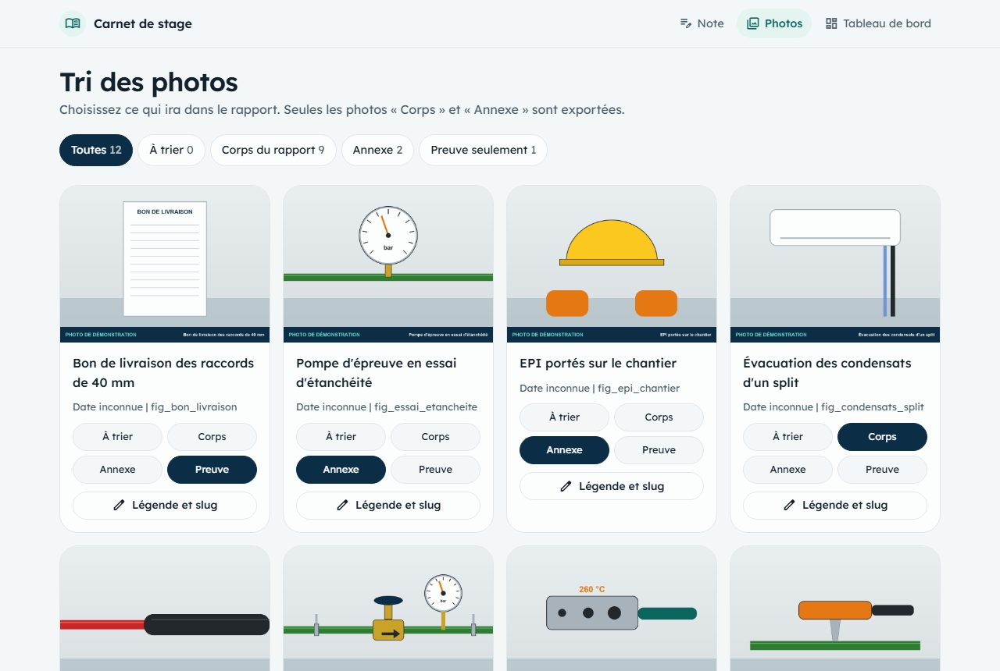

*Figure 18 : tri des photos. Chaque carte porte la légende, la date et le slug (`fig_<slug>`).*

Un seul clic change la destination :

| Destination | Exportée ? | Usage |
|---|---|---|
| À trier | non | valeur par défaut de toute nouvelle photo |
| Corps | oui | figure dans le texte du rapport (25 au plus conseillées) |
| Annexe | oui | figure en annexe, annoncée dans le texte |
| Preuve | non | justificatif gardé dans le carnet (ex. bon de livraison) |

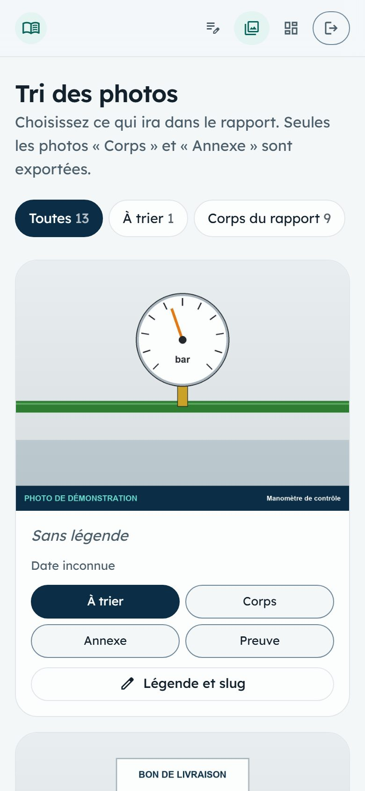

*Figure 19 : tri des photos sur téléphone. La photo de la note rapide arrive « À trier ».*

### Légende et slug

**Légende et slug** ouvre la fiche de la photo. Une photo **Corps** ou **Annexe** doit avoir une **légende**
(elle devient « Figure N : … ») et un **slug** unique dans le stage (le nom du fichier, `fig_<slug>.jpg`). Sans
eux, l'export est refusé et le message liste les photos à compléter.

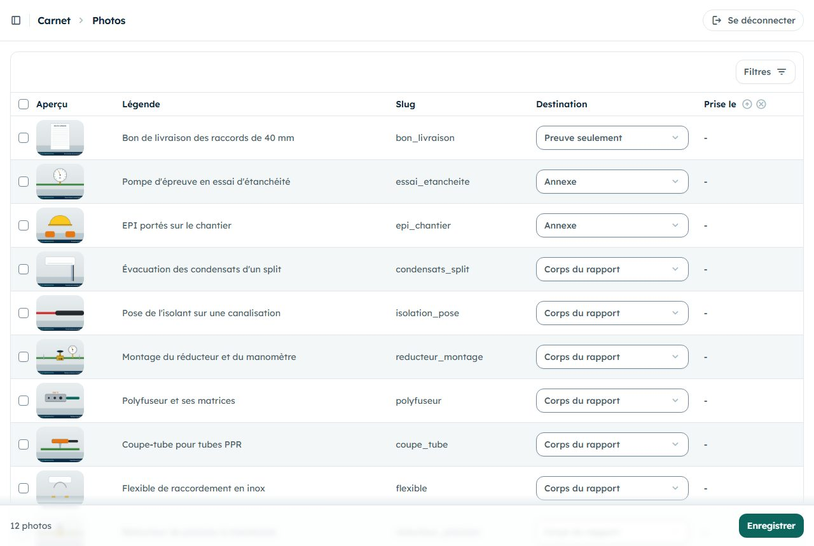

*Figure 20 : liste des photos dans l'admin : la destination se modifie aussi depuis la liste.*

Chaque photo est réduite à 1600 px et à environ 300 Ko. Ses coordonnées GPS et sa date de prise de vue (EXIF)
sont conservées.

> Les photos sont accessibles publiquement par leur adresse (choix assumé, A22). Ne photographiez ni
> documents confidentiels ni visages sans accord.

## 8. Lieux

**Lieux** recense le siège, les chantiers, les fournisseurs. Pour chacun : nom, type, latitude, longitude,
**repères** (« derrière la station-service, portail vert »), ville, quartier et nombre de niveaux du bâtiment.

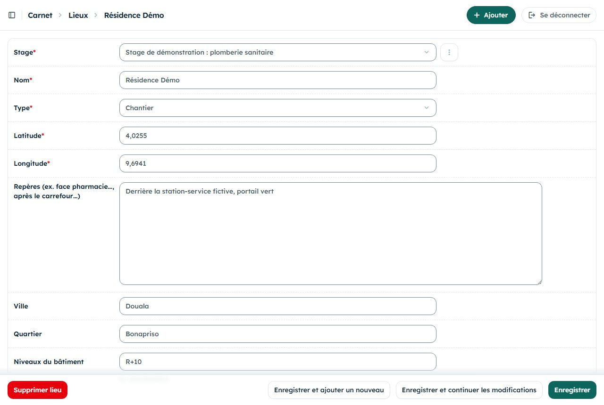

*Figure 21 : le chantier Résidence Démo.*

Pour obtenir les coordonnées, le plus simple est d'enregistrer une note rapide **sur place** puis de recopier sa
latitude et sa longitude (onglet **Liens** de la note). Les plans de situation sont dessinés plus tard, en local, à partir
d'OpenStreetMap : le siège donne la figure de localisation du rapport.

## 9. Rubriques et chapitres du thème

**Rubriques** contient deux niveaux :

- les **rubriques du cours**, fixes et communes à tous ;
- les **chapitres du thème**, propres à votre stage, que vous créez et ordonnez librement, avec un niveau de
  sous-chapitres. Ils forment le plan de la Partie III.

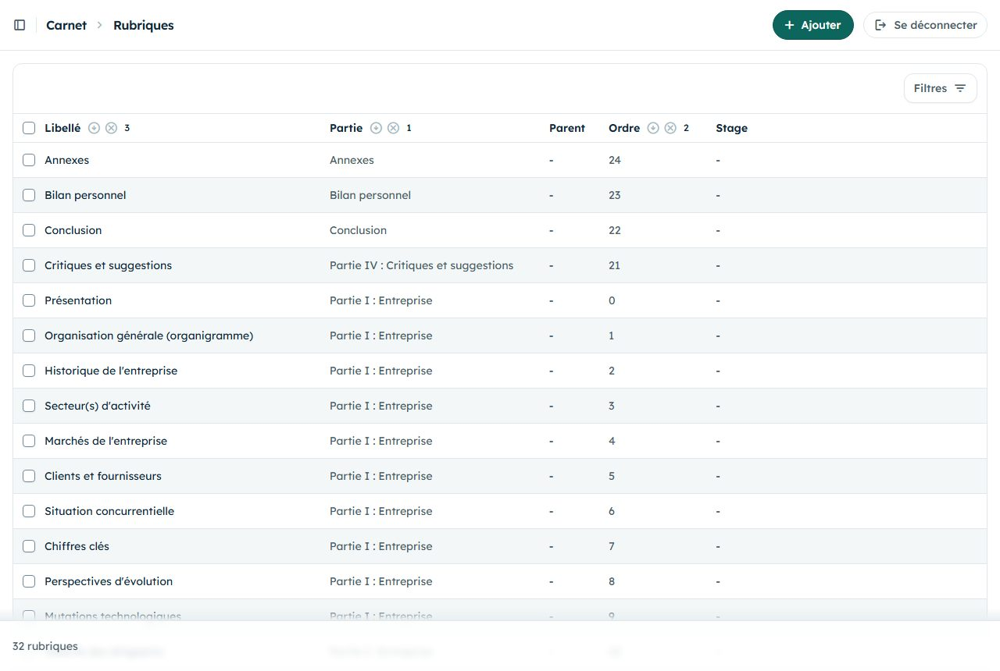

*Figure 22 : rubriques du stage de démonstration, dont les sept chapitres du thème « Plomberie sanitaire ».*

Les chapitres d'un stage sont invisibles des autres stages.

## 10. Données structurées

Ces listes produisent directement des figures, des tableaux et la bibliographie du rapport.

### Organigramme

Un poste par ligne, avec son nom (facultatif) et son **parent**. Un seul poste est marqué **Poste du stagiaire**.
Une boucle (un poste parent de lui-même, directement ou non) est refusée.

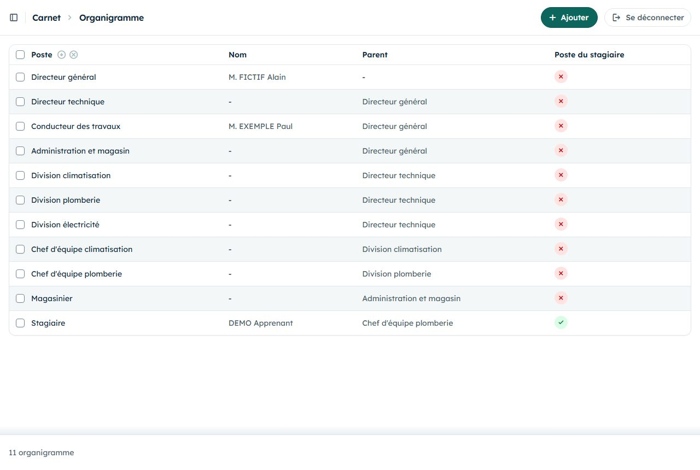

*Figure 23 : organigramme saisi : il devient `figures/organigramme.tex`.*

### Tâches (Gantt)

Libellé, dates, lieu, chapitre. Une tâche sans date de fin s'arrête à la fin du stage. Les tâches donnent le
diagramme de Gantt de la Partie II.

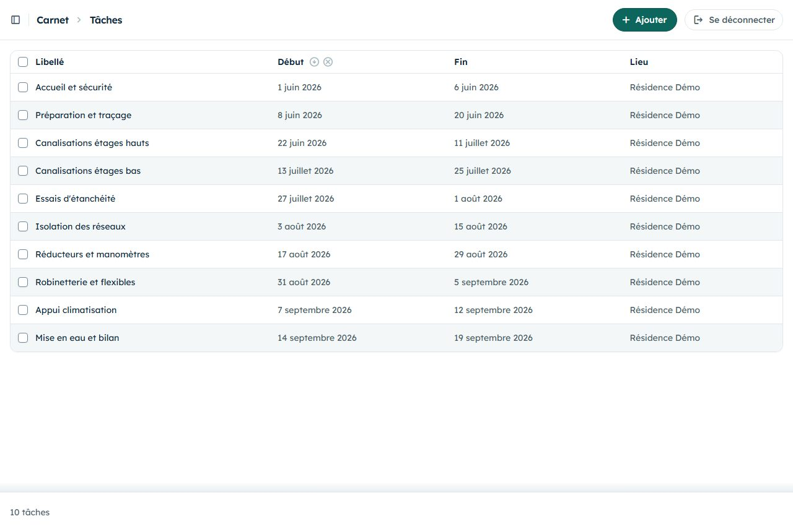

*Figure 24 : les dix tâches du stage de démonstration.*

### Équipements

Outillage, matériel ou matériau, EPI, appareils de mesure : désignation, caractéristiques, rôle, quantité, photo.
Chaque catégorie produit un tableau du rapport.

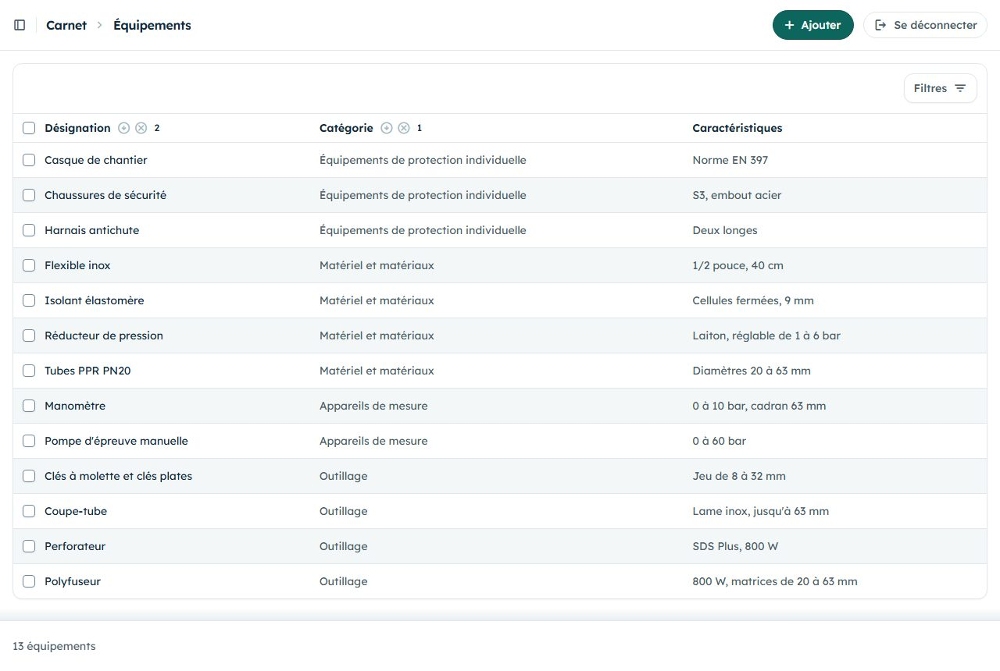

*Figure 25 : équipements.*

### Données techniques

Chaque chiffre du rapport doit être traçable :

- un **relevé** (mesuré sur le chantier) est rattaché à une **note du journal** ;
- une **valeur de référence** (norme, notice) exige une **source** de la bibliographie. Sans source, elle est
  refusée.

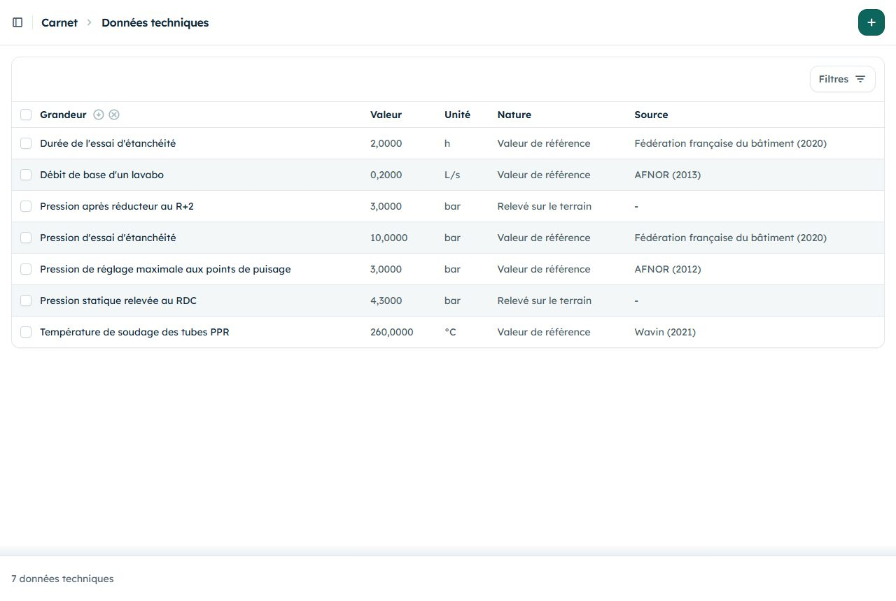

*Figure 26 : données techniques : relevés de pression et valeurs de référence.*

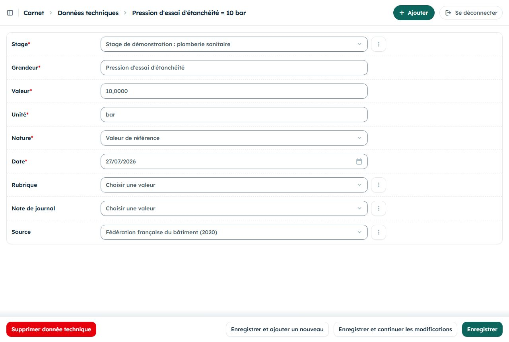

*Figure 27 : une valeur de référence et sa source.*

### Références

Normes, ouvrages, notices, pages web, informations orales. La clé BibTeX est générée (auteur et année) et
unique dans le stage.

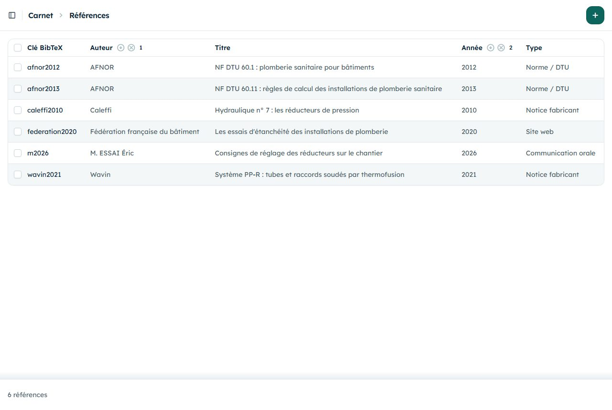

*Figure 28 : références bibliographiques.*

### Personnes

Nom, fonction, rôle, téléphone, et deux cases :

- **À remercier** : la personne figure dans les remerciements ;
- **Nom publiable** : sinon, le rapport la cite par sa **fonction**.

Le téléphone n'est **jamais** exporté.

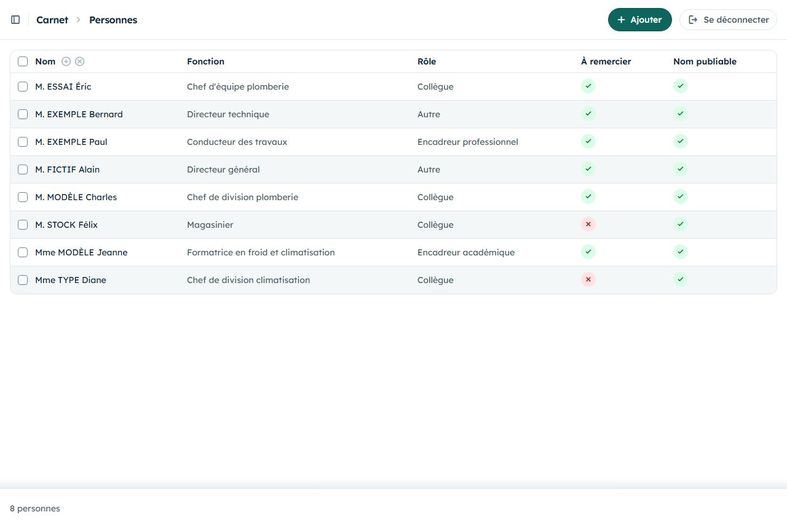

*Figure 29 : personnes.*

### Abréviations

Sigle (unique dans le stage) et signification : elles forment la liste des abréviations.

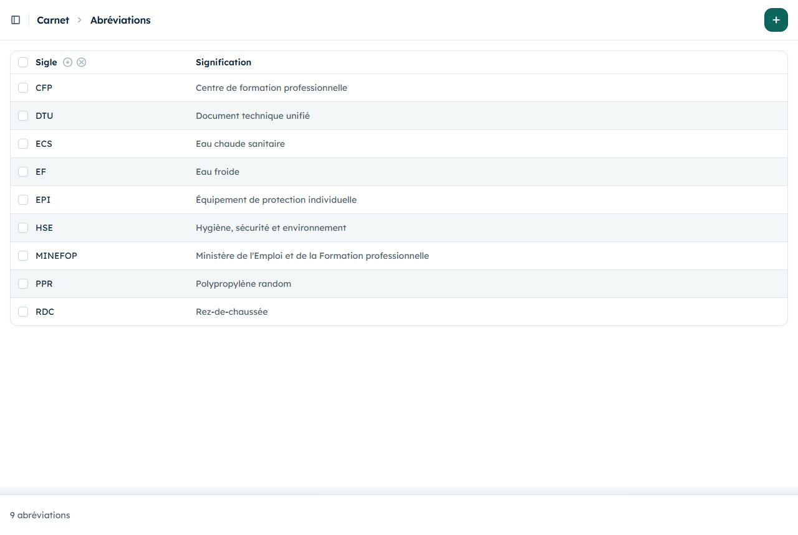

*Figure 30 : abréviations.*

## 11. Calendrier et absences

Les jours travaillés se règlent dans l'onglet **Suivi** du stage (lundi à samedi par défaut). **Absences**
recense ce qui n'est pas travaillé : jour férié, maladie, congé, intempérie, cours au centre de formation professionnelle. Les jours fériés fixes
du Cameroun sont déjà chargés pour tous ; ajoutez seulement vos absences.

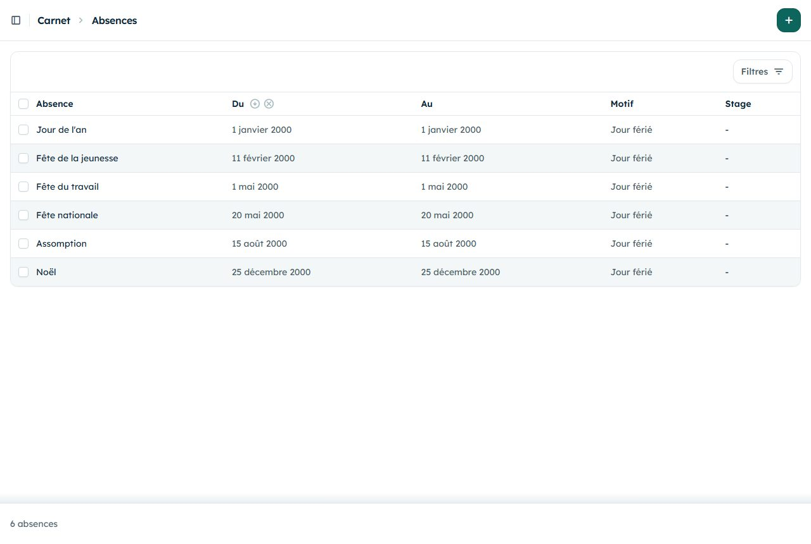

*Figure 31 : absences : les jours fériés communs sont préchargés.*

Les absences évitent les fausses alertes « Jours sans note » et donnent le taux de présence.

## 12. Dossier terrain : export et sauvegarde

Le bouton **Dossier terrain** du tableau de bord (ou le lien « Télécharger le zip » de la liste **Stages**)
télécharge un zip nommé
`dossier-terrain-<slug>-<date>.zip`. Il sert à deux choses :

- **sauvegarde** : téléchargez-le **chaque semaine**. Après 7 jours sans sauvegarde, l'indicateur passe en orange ;
- **rapport** : c'est ce zip que le superutilisateur importe en local pour rédiger le rapport.

*Figure 32 : après le téléchargement, « Dernière sauvegarde » indique « Aujourd'hui ».*

Contenu du zip de la démo (1,3 Mo) : `terrain.md` et `terrain.json` (toutes les données, classées selon le plan
du cours), `config/infos.tex` (couverture), `figures/organigramme.tex`, `figures/gantt.tex`, quatre tableaux
d'équipements, `bib/references.bib`, les 11 photos Corps et Annexe, les logos, une copie de sauvegarde de toutes
les photos et un `manifest.json` avec les sommes de contrôle.

Le zip est fabriqué à la volée et n'est jamais stocké sur le serveur. Gardez-le en lieu sûr (clé USB, disque) ;
le superutilisateur peut le restaurer dans l'application avec `restaurer_dossier` en cas de perte.

Si l'export est refusé, le message commence par « Export impossible : » et liste les photos Corps ou Annexe
sans légende ou sans slug. Complétez-les (section 7), puis recommencez.

## 13. Et ensuite : le rapport

L'application ne rédige rien et ne compile rien. En fin de stage :

1. vous téléchargez le dossier terrain et le remettez au superutilisateur ;
2. il l'importe en local (`importer_dossier`), Claude Code rédige le rapport **uniquement** à partir de
   `terrain.md`, puis le PDF et la présentation sont produits ;
3. ce qui n'a pas été saisi apparaît en « [À COMPLÉTER] » dans le PDF.

La procédure est dans [docs/rapport-local.md](../rapport-local.md). Le résultat de la démo :
[demo/rapport_demo.pdf](../../demo/rapport_demo.pdf), sa version Word [demo/rapport_demo.docx](../../demo/rapport_demo.docx)
et [demo/presentation_demo.pptx](../../demo/presentation_demo.pptx).

## 14. Le formateur et le rapport

Le formateur n'a pas de compte dans le Carnet (B17). Son nom est un simple libellé : saisissez-le dans le
stage, onglet **Couverture**, champ **Formateur (responsable académique)**, avec son poste. Il est imprimé sur
la couverture du rapport. Pour faire relire votre travail, montrez-lui vos notes sur le téléphone ou
envoyez-lui le dossier terrain. Personne d'autre que vous (et l'administrateur du centre) ne voit vos notes.

## 15. Questions fréquentes

**Je ne vois pas les données d'un camarade.** C'est voulu : chaque apprenant ne voit que ses stages.

**La position reste « non captée ».** Autorisez la localisation pour le site dans le navigateur, activez le GPS
du téléphone, puis rechargez : le brouillon est conservé.

**J'ai écrit une note sans réseau.** Le texte est gardé dans le navigateur. Enregistrez quand le réseau revient.
Les photos choisies, elles, doivent être sélectionnées à nouveau.

**La date de ma note est fausse.** La Note rapide prend la date du jour. Pour une note oubliée, créez-la depuis
**Journal → Ajouter** et choisissez la date.

**Le quota est atteint.** Passer une photo en « Preuve » ne libère pas de place : supprimez les photos inutiles
dans **Photos**, ou demandez une augmentation au superutilisateur.

**Ce qui n'est pas prévu** : application hors ligne, application mobile, inscription libre, mot de passe oublié
par courriel, rédaction automatique dans l'application.

---

*Captures prises le 6 novembre 2026 avec le compte `demo.apprenant`, en local, par
[capturer_ecrans.py](capturer_ecrans.py) (Playwright : 1280 px pour le bureau, 390 px pour le téléphone, GPS
simulé sur le chantier).*
