# Scénario visuel : un stage avec le Carnet, du premier au dernier jour

Ce scénario suit **DEMO Apprenant**, stagiaire en *Froid et climatisation* chez EDEMO, sur le chantier Résidence
Démo (R+10, Douala), du **lundi 1er juin** au **samedi 19 septembre 2026**. Toutes les données sont celles du
compte `demo.apprenant` / `demo-local-2026` ; elles sont fictives.

Le mode d'emploi de chaque écran est dans le [manuel d'utilisation](manuel-utilisation.md). Ici, on suit le
**rythme d'usage** : ce que l'apprenant fait, où, avec quel écran, et ce que cela produit dans le rapport.

## Vue d'ensemble

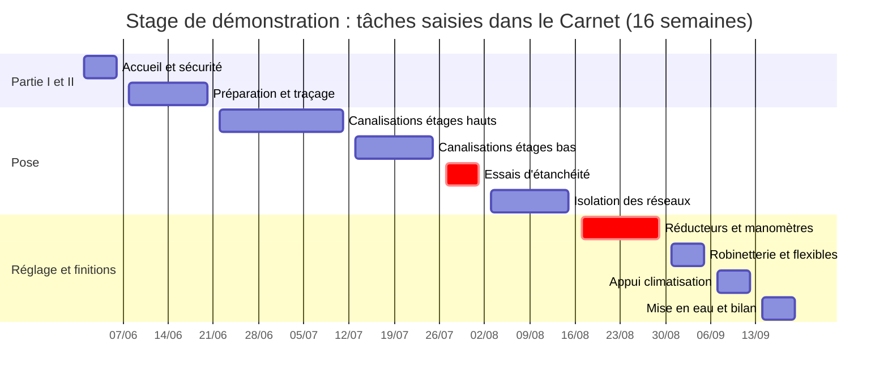

Le rythme se résume en trois boucles :

| Quand | Où | Écran | Durée visée |
|---|---|---|---|
| **Chaque jour**, sur le terrain | téléphone | Note rapide : texte, photo, GPS | moins de 60 s |
| **Chaque soir ou samedi** | téléphone ou ordinateur | Journal : compléter les notes ; Tri des photos | 15 à 30 min |
| **Chaque semaine** | ordinateur | Tableau de bord : corriger ce qui est orange ; Dossier terrain (sauvegarde) | 5 min |

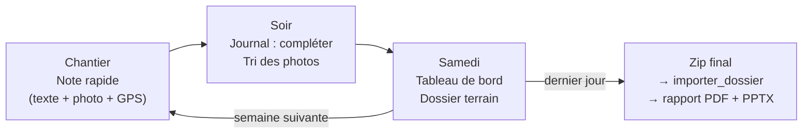

---

## Avant le stage : créer son compte (vendredi 29 mai)

**Qui agit.** L'apprenant, seul : sur l'accueil, *Par où commencer* puis *Créer un compte*. L'inscription est
libre, en tant qu'apprenant ; le compte s'active par le lien reçu par courriel. (Le compte `demo.apprenant` de ce
scénario a été préparé par `charger_demo`.)

**L'apprenant** se connecte une première fois sur un ordinateur, pour vérifier son accès.

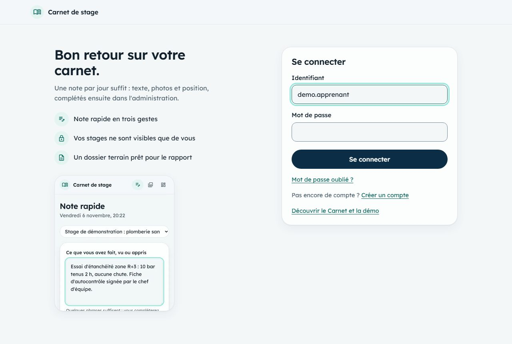

---

## Jour 1 : lundi 1er juin, accueil et sécurité

### 7 h 30, au siège : créer le stage

Sans stage, le tableau de bord affiche « Bienvenue » et le bouton **Créer mon stage**. L'apprenant saisit
l'intitulé, la spécialité, le thème, l'entreprise et les dates. Le reste de la couverture (tuteurs, centre de formation professionnelle,
diplôme, logos) peut attendre : un champ vide ne bloque rien.

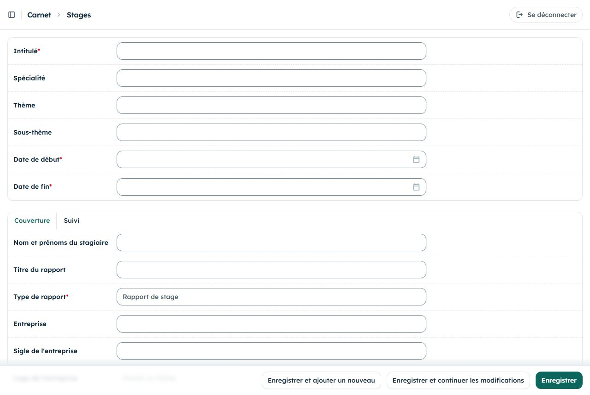

### 8 h, le tableau de bord du premier jour

Le stage existe mais tout est à faire. Deux cases sont déjà **orange** : *Jours sans note* (la journée a commencé)
et *Dernière sauvegarde : Jamais*. Les **20 rubriques** du cours sont vides.

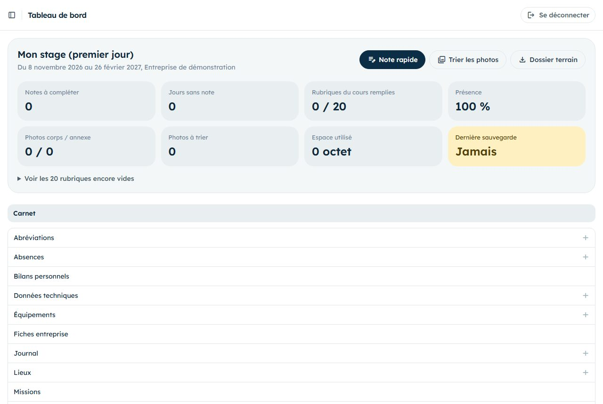

*Ce qu'il faut retenir dès le jour 1 : le tableau de bord dit ce qui manque. L'objectif du stage est de tout
faire passer au vert.*

### 10 h, sur le chantier : première note rapide

Pendant la visite du chantier, l'apprenant ouvre la Note rapide sur son téléphone. La position est captée et
rattachée au lieu le plus proche.

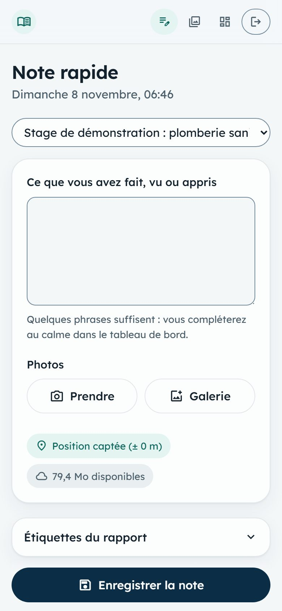

Il note : « Accueil par le conducteur des travaux et présentation de l'entreprise. Visite du chantier, consignes
de sécurité, remise des EPI. » et coche les étiquettes *Présentation de l'entreprise*, *Organisation générale*
et *Poste occupé*.

### 17 h, le soir : poser les fondations

De retour, sur l'ordinateur, il saisit ce que l'on apprend le premier jour et qu'on oublie ensuite :

- **Lieux** : le siège (Akwa) et le chantier (Bonapriso, R+10), avec leurs repères ;
- **Personnes** : le conducteur des travaux (encadreur professionnel), le chef d'équipe plomberie,
  le magasinier ; cases *À remercier* et *Nom publiable* ;
- **Organigramme** : les postes, du directeur général au stagiaire, rattaché au chef d'équipe plomberie.

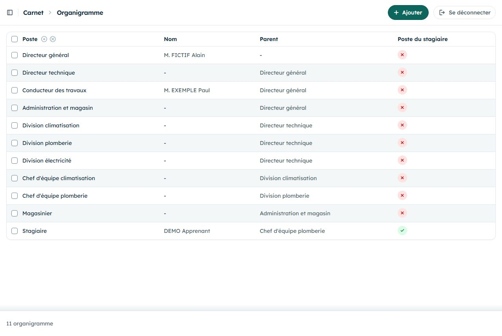

---

## Semaine 1 : 2 au 6 juin, la fiche entreprise prend forme

**Chaque jour** : une note rapide (moins d'une minute).

**Au fil des échanges** avec le conducteur des travaux, l'apprenant remplit la **Fiche entreprise** : présentation,
organisation, historique (2010, 2014, 2019, 2024). Il ne recopie pas une brochure : il écrit ce qu'on lui a dit et
cite la source orale si besoin.

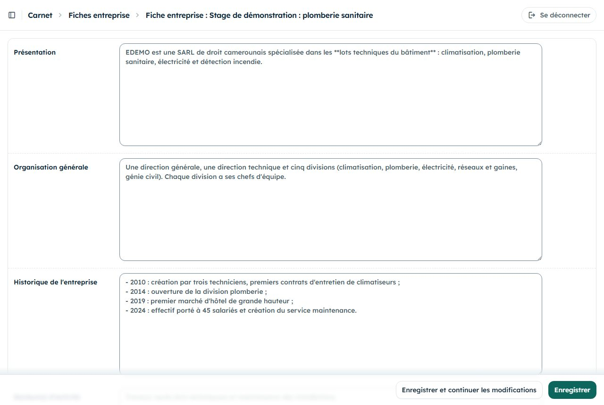

**Samedi 6 juin, au calme** : il complète les six notes de la semaine (onglet *Rapport d'activité* : objectifs,
moyens, méthodologie, difficultés, solutions) et télécharge son **premier dossier terrain**. La case *Dernière
sauvegarde* passe au vert.

---

## Semaines 2 et 3 : 8 au 20 juin, préparation et traçage

**Mercredi 10 juin** : en lisant le DTU 60.11 avec le chef d'équipe, l'apprenant saisit sa première **valeur de
référence** : débit de base d'un lavabo, 0,20 L/s. L'application refuse de l'enregistrer tant qu'il ne choisit
pas la **source** : il crée d'abord la référence « NF DTU 60.11 » dans **Références**.

**Inventaire du matériel** : chaque outil, matériau, EPI ou appareil de mesure rencontré est saisi une fois dans
**Équipements**. Il sera relié ensuite aux notes et deviendra un tableau du rapport.

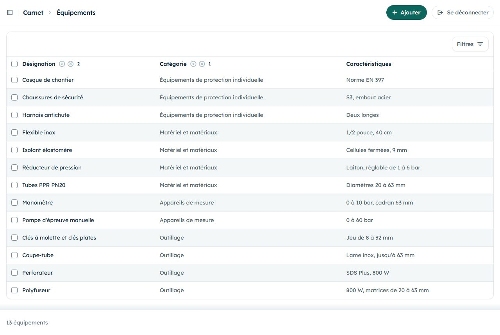

**Chapitres du thème** : à la fin de la semaine 3, le plan de la Partie III se dessine. L'apprenant crée ses sept
chapitres dans **Rubriques** (généralités, présentation du chantier, dimensionnement, matériels, modes
opératoires, HSE, liens avec le froid). Dès lors, ses notes peuvent porter ces étiquettes.

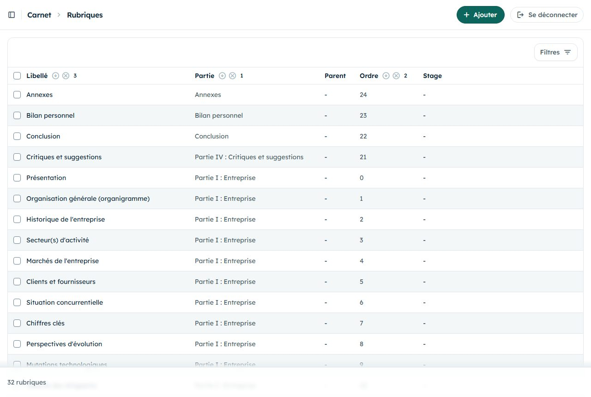

---

## Semaines 4 à 6 : 22 juin au 11 juillet, polyfusion aux étages hauts

**Lundi 22 juin** : la notice du fabricant donne la température de soudage des tubes PPR, **260 °C**. Valeur de
référence, source *Wavin*.

**Un incident** : un assemblage mal chauffé fuit au premier essai. Le soir, l'apprenant complète la note avec
l'onglet **Intervention** (nature : reprise d'un assemblage PPR défectueux ; immobilisation 3 h ; coût
15 000 F CFA ; ressources) : c'est un « fait important » de la Mission.

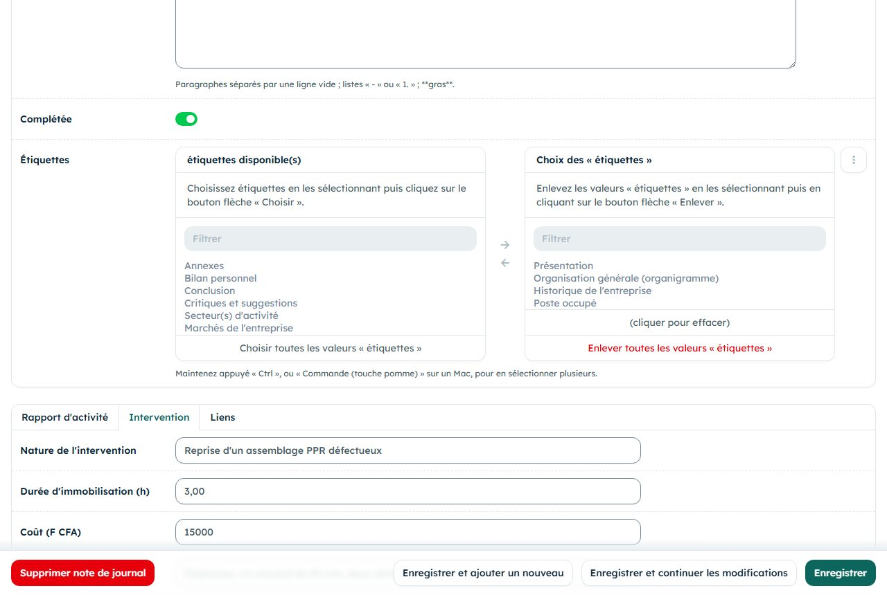

**Les photos** s'accumulent : polyfuseur, coupe-tube, façade du chantier. Elles arrivent toutes « À trier ».

---

## Semaines 7 et 8 : 13 au 25 juillet, étages bas et rupture d'approvisionnement

**Une difficulté** : rupture de raccords de 40 mm, deux jours de retard. L'apprenant photographie le bon de
livraison. Cette photo n'ira pas dans le rapport : il la classe en **Preuve**.

**Samedi 25 juillet, tri des photos** : en grille, un clic par photo. *Corps* pour ce qui illustre le texte,
*Annexe* pour le reste utile, *Preuve* pour les justificatifs. Pour chaque photo *Corps* ou *Annexe* : une
**légende** et un **slug**.

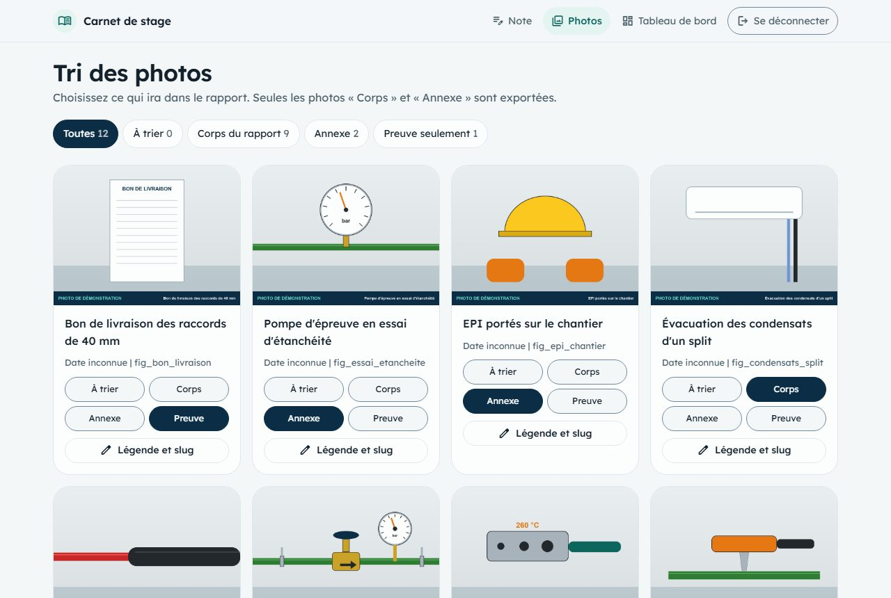

---

## Semaine 9 : 27 juillet au 1er août, essais d'étanchéité

**Lundi 27 juillet, sur le chantier** : essai par zone à **10 bar pendant 2 h**. Note rapide avec la photo du
manomètre et l'étiquette *Mise en œuvre : modes opératoires*.

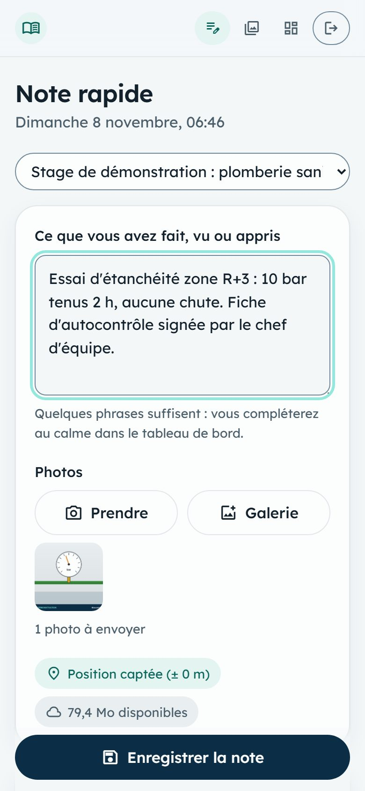 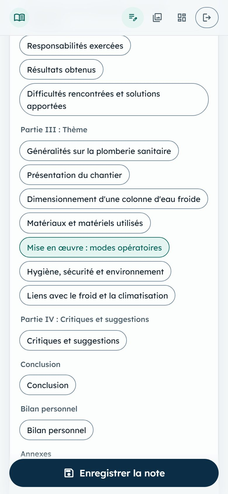 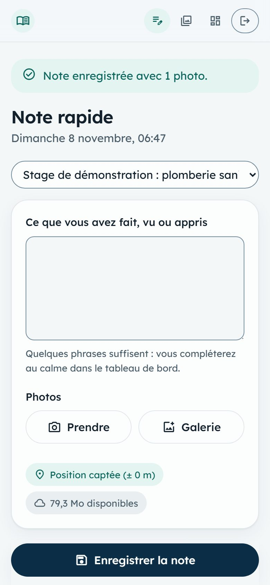

*Écrire, photographier, enregistrer : trois actions. La note est datée, géolocalisée et étiquetée.*

**Le soir**, il saisit les deux valeurs prescrites (10 bar, 2 h) avec leur source, la FFB.

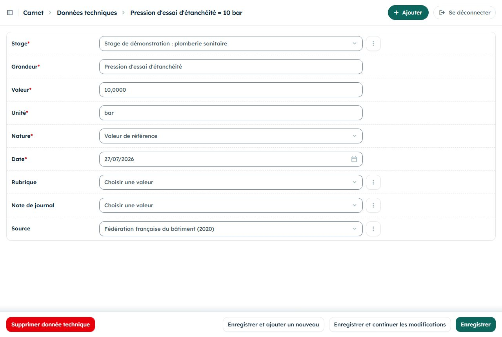

---

## Semaines 10 et 11 : 3 au 15 août, isolation des réseaux

L'isolant élastomère à cellules fermées fait le lien avec la spécialité : point de rosée, condensation, même
matériau qu'en climatisation. Les notes portent l'étiquette *Liens avec le froid et la climatisation*.

**Samedi 15 août** (Assomption, jour férié préchargé) : rien à déclarer, le jour n'est pas compté comme « sans
note ». Pour une absence personnelle (maladie, cours au centre de formation professionnelle), l'apprenant l'ajoute dans **Absences**.

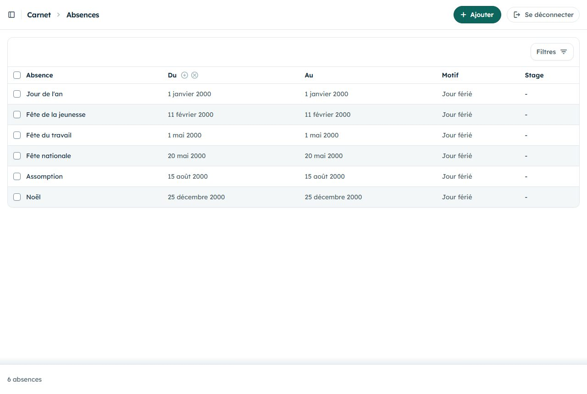

---

## Semaines 12 et 13 : 17 au 29 août, réducteurs et manomètres

**Lundi 17 août** : premier **relevé** du stage. Pression statique au RDC : **4,3 bar**. Un relevé est rattaché
à la note du jour : il prouve que le chiffre a été mesuré sur place.

**Lundi 24 août** : après réglage, **3,0 bar** au R+2. Le DTU 60.1 fixe 3 bar au plus aux points de puisage :
valeur de référence, source *DTU 60.1*.

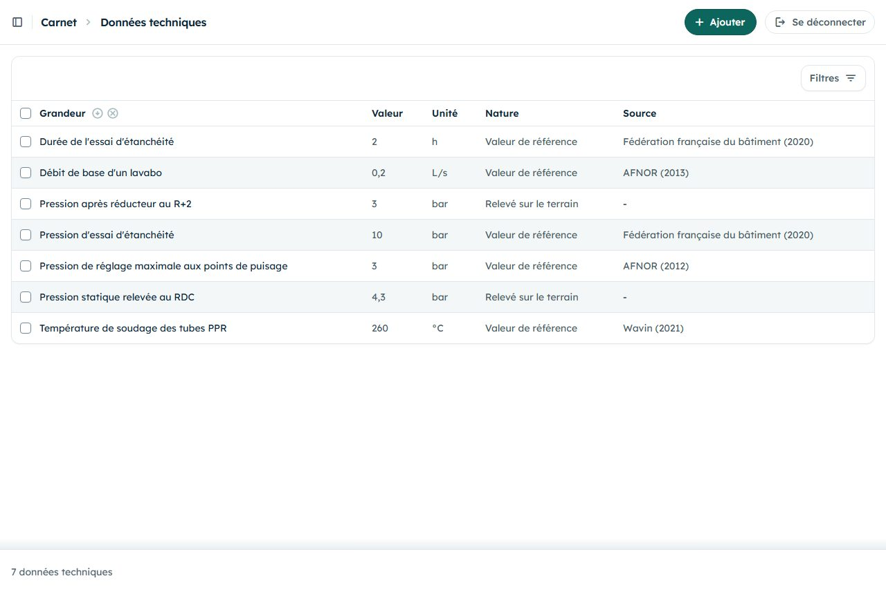

La note du 17 août, complétée le soir même :

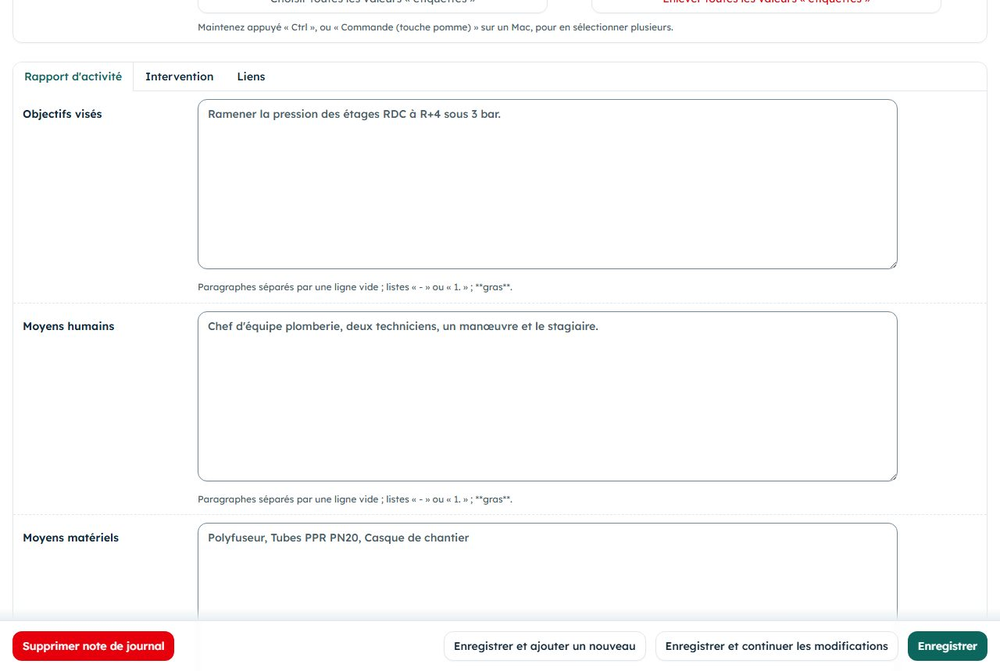

---

## Semaines 14 et 15 : 31 août au 12 septembre, finitions et appui climatisation

Robinetterie et flexibles, puis une semaine avec l'équipe climatisation : liaisons frigorifiques, évacuation des
condensats d'un split. La **Mission** et le **Bilan personnel** se remplissent au fil des jours : collaborateurs,
responsabilités, ce que l'on a apprécié, critiques.

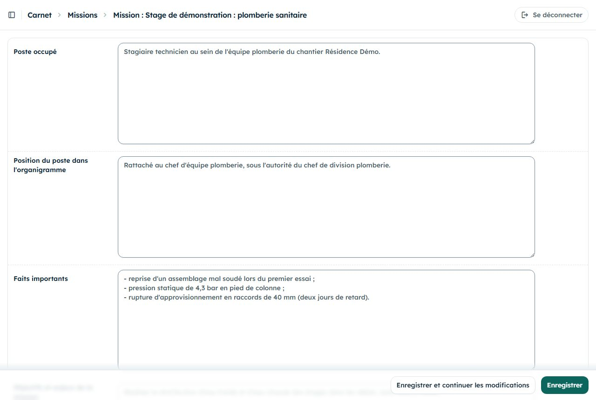

---

## Dernière semaine : 14 au 19 septembre, mise en eau et bilan

**Lundi au vendredi** : mise en eau, purge par les points hauts, réglage final des pressions. Notes rapides
comme chaque jour.

**Vendredi 18 septembre** : l'apprenant termine le **Bilan personnel** (critiques et suggestions) et vérifie que
chaque photo *Corps* et *Annexe* a sa légende et son slug.

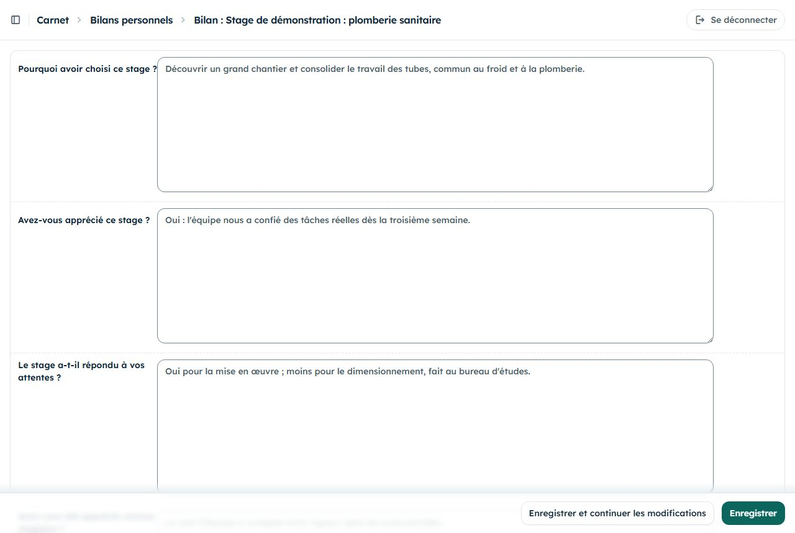

### Samedi 19 septembre, dernier jour

**Bilan avec le tuteur professionnel**, puis dernière note rapide. Le soir, le tableau de bord est entièrement
au vert :

| Indicateur | Jour 1 | Dernier jour |
|---|---|---|
| Notes à compléter | 0 | **0** sur 95 notes |
| Jours sans note | 1 | **0** |
| Rubriques du cours remplies | 0 / 20 | **20 / 20** |
| Présence | 100 % | **100 %** |
| Photos corps / annexe | 0 / 0 | **9 / 2** |
| Photos à trier | 0 | **0** |
| Dernière sauvegarde | Jamais | **Aujourd'hui** |

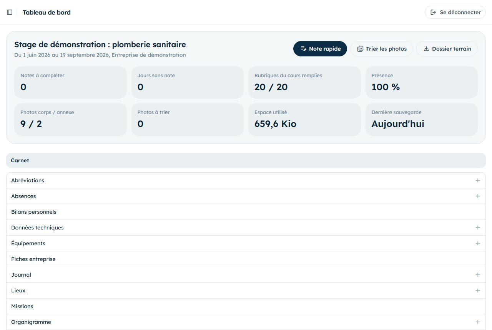

**Dernière action dans l'application** : **Dossier terrain**. Le zip final (1,3 Mo) contient tout ce qui a été
saisi en 16 semaines, classé selon le plan du cours. L'apprenant le garde et le remet au superutilisateur.

Le journal complet, à montrer au formateur pour la relecture :

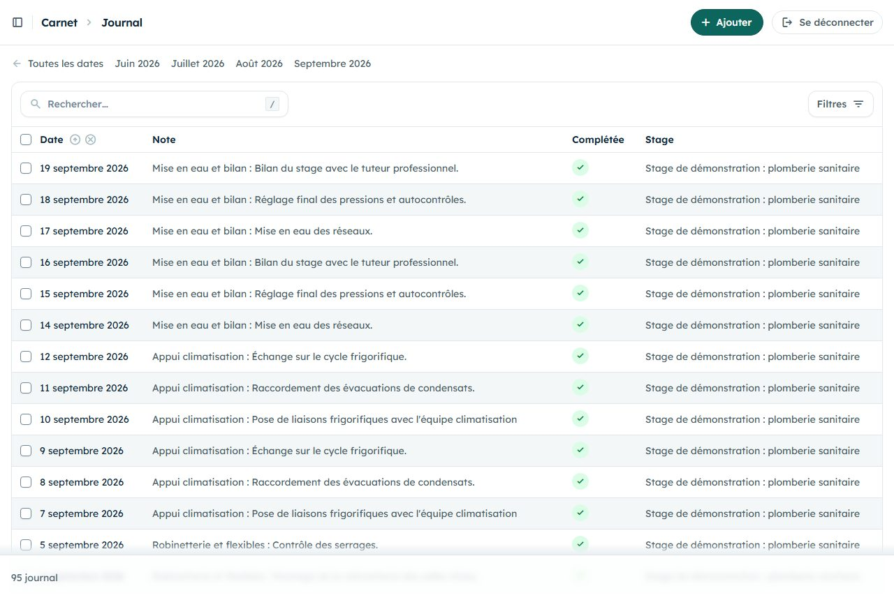

---

## Après le stage : du zip au rapport

En local, le superutilisateur importe le zip (`importer_dossier`). Claude Code rédige le rapport **à partir de
`terrain.md` seulement**, puis le PDF et la présentation sont produits (voir
[docs/rapport-local.md](../rapport-local.md)). Ce que l'apprenant a saisi devient directement :

| Saisi dans le Carnet | Devient dans le rapport |
|---|---|
| Stage, onglet Couverture, logos | page de couverture |
| Siège (Lieux) | plan de localisation (OpenStreetMap) |
| Organigramme | figure de l'organigramme |
| Tâches | diagramme de Gantt |
| Photos *Corps* et légendes | figures du texte |
| Équipements | tableaux par catégorie |
| Données techniques et Références | chiffres sourcés et bibliographie |
| Personnes *À remercier* | remerciements |
| Abréviations | liste des abréviations |
| Fiche entreprise, Mission, Bilan, notes | Parties I à IV et conclusion |

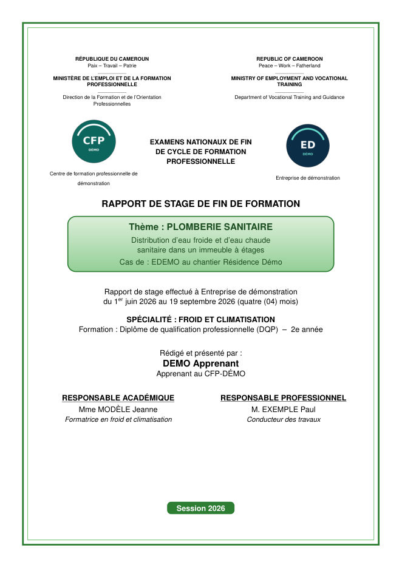 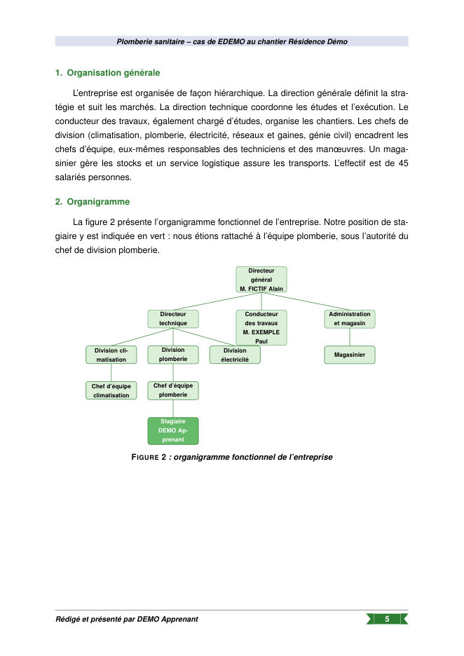 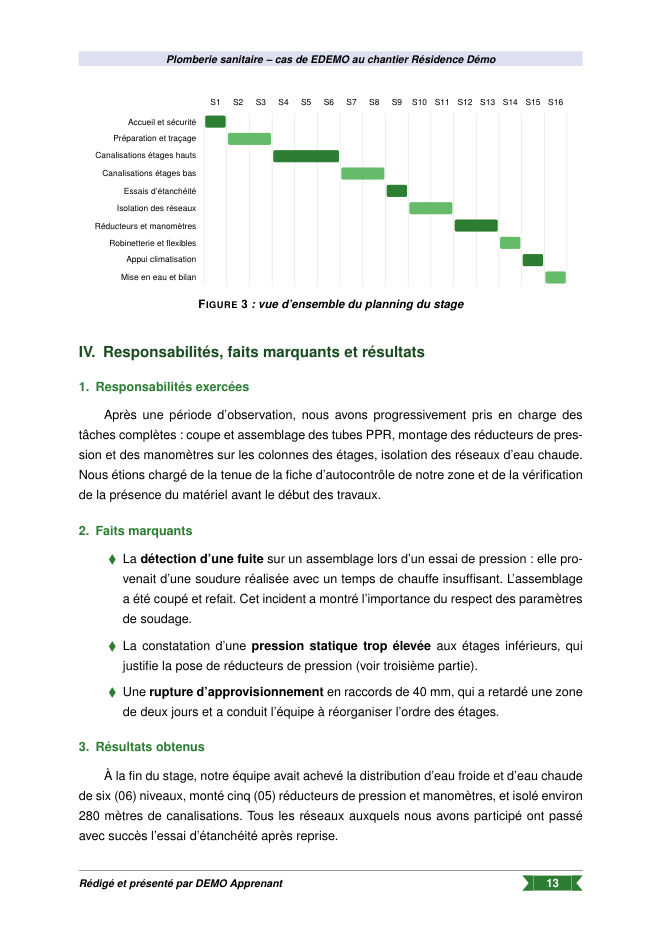 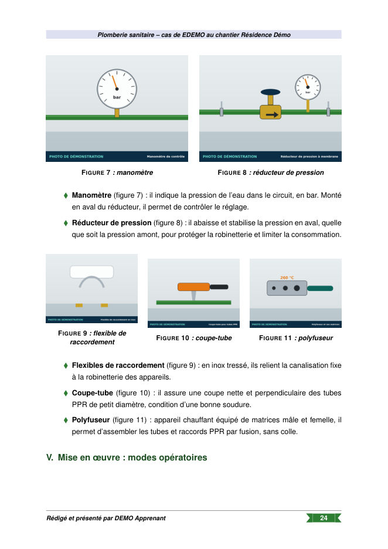

*Le rapport de la démo : couverture, organigramme, Gantt et photos du corps. PDF complet :
[demo/rapport_demo.pdf](../../demo/rapport_demo.pdf) (50 pages) ; présentation :
[demo/presentation_demo.pptx](../../demo/presentation_demo.pptx).*

---

## Les bons réflexes, en une page

1. **Une note par jour travaillé**, même courte, sur le terrain. Le texte se complète le soir.
2. **Une photo vaut une note** : photographiez le matériel, les étapes, les plaques signalétiques.
3. **Chaque chiffre a une origine** : relevé (avec sa note) ou valeur de référence (avec sa source).
4. **Les noms se notent le premier jour** : personnes, fonctions, organigramme.
5. **Le samedi** : compléter les notes, trier les photos, télécharger le dossier terrain.
6. **Viser le vert** : chaque case orange du tableau de bord est une information qui manquera au rapport.
